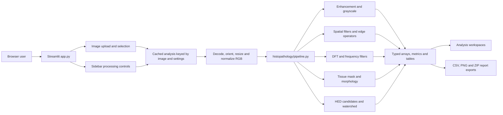
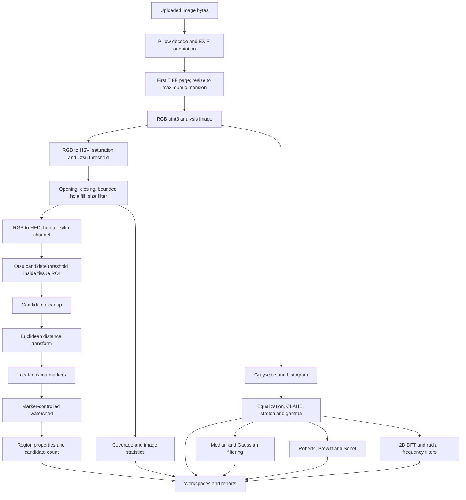
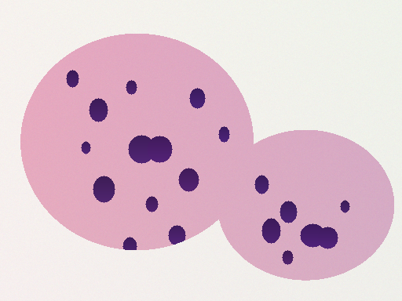

# HistoScope

**A classical Digital Image Processing (DIP) workstation for histopathology image exploration.**

HistoScope is an educational Streamlit application for inspecting RGB microscopy images, comparing conventional enhancement and filtering methods, and exploring heuristic tissue and nuclei-candidate segmentation. It uses thresholding, color transforms, morphology, Fourier filtering, distance transforms and watershed segmentation. It does not use machine learning, make diagnoses or provide clinically validated measurements.

> **Research and education only.** HistoScope is not a medical device and must not be used to guide clinical decisions. Candidate masks and counts can be wrong. Inspect the results against the source image.

## Contents

- [Problem and objectives](#problem-and-objectives)
- [Features](#features)
- [Technology](#technology)
- [Architecture](#architecture)
- [Processing pipeline](#processing-pipeline)
- [Implemented DIP methods](#implemented-dip-methods)
- [Installation on Windows](#installation-on-windows)
- [Run the application](#run-the-application)
- [Run tests](#run-tests)
- [Docker](#docker)
- [Reproducible sample and results](#reproducible-sample-and-results)
- [Demonstration workflow](#demonstration-workflow)
- [Limitations](#limitations)
- [Future work](#future-work)
- [References and data attribution](#references-and-data-attribution)
- [Project files](#project-files)

## Problem and objectives

Histopathology images contain color and structural variation at multiple scales. Introductory DIP courses often teach equalization, spatial filters, edge operators, frequency-domain filters and segmentation as isolated operations. HistoScope brings these techniques together in an interactive workstation so students can inspect intermediate results and relate parameter changes to the output.

Project objectives:

1. Implement and expose conventional image-processing operations in modular Python functions.
2. Preserve an understandable processing path from decoded RGB image to measurements and exports.
3. Show intermediate masks and responses instead of hiding segmentation decisions.
4. Make edge cases, display scaling and dtype choices explicit.
5. Provide a reproducible synthetic demonstration with known generated masks, while clearly separating it from clinical validation.

## Features

- Upload one or multiple PNG, JPEG, BMP and TIFF images; choose the current image for analysis. Multi-page TIFF uses the first page.
- Decode, EXIF-orient, convert to RGB `uint8`, and resize the longest edge to a user-selected limit before analysis.
- Inspect image metadata, channels, grayscale values and a 256-bin pixel-count histogram.
- Compare histogram equalization, CLAHE, percentile contrast stretching and gamma correction.
- Adjust median and Gaussian filtering and compare Roberts, Prewitt and Sobel edge maps.
- Explore centered DFT magnitude and ideal, Butterworth or Gaussian low-/high-pass results.
- Inspect HSV saturation tissue masks at raw, opening, closing and final-cleanup stages, including foreground coverage and boundary overlay.
- Explore HED hematoxylin candidates, distance transform, watershed markers, labels and overlay.
- Review tissue coverage and heuristic region properties; export CSV tables and a ZIP report bundle.
- Run a per-image-isolated batch summary for multiple uploads.

All algorithms are conventional DIP. No neural network, pretrained model, cloud inference or ML classifier is included.

## Technology

| Component | Role |
|---|---|
| Python | Application and algorithm implementation |
| Streamlit | Local browser interface, navigation, controls and downloads |
| NumPy / pandas | Arrays, histograms, metrics and tables |
| OpenCV | RGB-to-gray, histogram equalization, CLAHE and spatial filters |
| scikit-image | Color/stain transforms, thresholding, morphology, edge operators, region properties and watershed |
| SciPy | Euclidean distance transform and connected-component/hole operations |
| Pillow | Image decoding, orientation handling and PNG creation |
| pytest | Automated pipeline regression tests |

`requirements.txt` and `pyproject.toml` declare matching runtime dependency ranges. `opencv-python-headless` is the only OpenCV distribution. Python 3.10 or later is declared; Python 3.11+ is recommended for a new setup.

## Architecture

The interface manages uploads and parameter state, then calls one cached analysis function. The processing module returns typed NumPy arrays, metrics and measurements. Presentation conversions are made only for display and export; the computational Boolean masks and integer label arrays are preserved.



## Processing pipeline



The image loader makes a working copy. For high-bit-depth grayscale, the 1st and 99th intensity percentiles map to 0 and 255; this is a display/analysis conversion, not lossless archiving. Transparent input is composited onto white. Large source images are resized in Pillow before conversion to a NumPy working array. Measurement values are in analysis-image pixels; no physical pixel calibration is provided.

## Implemented DIP methods

### Image fundamentals

- **RGB channels:** direct red, green and blue planes from the RGB-order image.
- **Grayscale:** OpenCV RGB-to-gray conversion, approximately `Y = 0.299R + 0.587G + 0.114B`; output is 2-D `uint8`.
- **Histogram:** 256 integer bins over `[0, 256)`. Counts sum to the number of grayscale pixels; the chart is not a probability density.

### Enhancement

- **Histogram equalization:** global cumulative-histogram mapping (`cv2.equalizeHist`). It redistributes intensity values globally and can also expand noise in sparse histogram ranges.
- **CLAHE:** contrast-limited adaptive histogram equalization using OpenCV 8 x 8 tiles and the exposed clip limit. Local contrast can increase noise or stain variation.
- **Contrast stretching:** the 1st and 99th grayscale percentiles map linearly to 0 and 255, with values outside clipped. Constant images are left unchanged.
- **Gamma correction:** `I_out = 255 (I_in / 255)^gamma`. Gamma below one brightens mid-tones; gamma above one darkens them.

### Spatial filters and edges

- **Median filter:** replaces a pixel with the median in an odd-sized neighborhood; useful for impulse noise. The selected kernel is reduced for tiny images when necessary.
- **Gaussian filter:** convolution with a separable Gaussian kernel controlled by sigma in pixel units. It reduces high-frequency detail and softens edges.
- **Roberts, Prewitt and Sobel:** library gradient operators estimate local intensity derivatives. Each magnitude map is normalized by its own maximum for display. The Boolean edge map thresholds positive normalized responses at the selected per-image percentile. Magnitudes are therefore not directly comparable between images.

### Frequency-domain filters

For grayscale `I`, the implementation computes `F = fftshift(fft2(I))`. The spectrum panel displays `log(1 + |F|)` after visualization scaling. Frequency coordinates are centered cycles-per-pixel bins, and `D` is radial distance from the zero-frequency center. With normalized cutoff `D0`:

- **Ideal low-pass:** `H_lp(D) = 1` for `D <= D0`, otherwise zero.
- **Butterworth low-pass:** `H_lp(D) = 1 / (1 + (D / D0)^(2n))`, with order `n`.
- **Gaussian low-pass:** `H_lp(D) = exp(-D^2 / (2 D0^2))`.
- **High-pass:** the complement `H_hp = 1 - H_lp`.

Filtering multiplies the centered spectrum by the transfer function and applies `ifftshift` and the inverse 2-D FFT. Low-pass output is rounded and clipped to the original 8-bit range. High-pass is a signed response mathematically, but the UI/export presents the absolute response percentile-scaled for visibility; it is not a reconstructed intensity image.

### Color, tissue and nuclei-candidate segmentation

- **HSV:** RGB is converted to float `[0,1]` before RGB-to-HSV conversion. The saturation channel is used for an Otsu threshold with a configurable lower floor; foreground is `S > max(Otsu, floor)`.
- **Tissue morphology:** opening, closing, small-hole filling bounded by the structuring-element area, and small-component removal are applied to a Boolean mask. If the raw saturation mask selects more than half the image perimeter, an Otsu-thresholded RGB distance from the perimeter's median color is used as a fallback morphology input. The raw saturation mask remains available for comparison. Boundary pixels are then located for an overlay.
- **Hematoxylin component:** scikit-image RGB-to-HED color deconvolution supplies the hematoxylin plane. Otsu thresholding is performed inside the estimated tissue ROI, followed by disk-1 opening, small-component removal and bounded hole filling.
- **Distance transform:** Euclidean distance to the nearest background pixel is computed for cleaned candidate foreground.
- **Watershed:** local maxima of the distance map, separated by the configurable minimum peak distance, seed integer markers. Watershed floods `-distance` inside the candidate mask. If a non-empty mask yields no maxima, connected-component labels provide fallback markers.
- **Region properties:** non-background labels are measured for pixel area, perimeter, eccentricity, solidity, equivalent diameter, centroid and mean hematoxylin intensity. Border-truncated regions have incomplete geometry.

These tissue and nuclei workflows are educational heuristics. They can include background, omit tissue, merge nuclei or split one nucleus into multiple labels. They are not validated cell counts.

## Installation on Windows

Use PowerShell from the cloned project directory. Python 3.11 or newer is recommended; the declared minimum is Python 3.10.

```powershell
git clone https://github.com/nahhadi/Histopathology-Image-Enhancement-and-Tissue-Segmentation.git
Set-Location Histopathology-Image-Enhancement-and-Tissue-Segmentation
py -m venv .venv
.\.venv\Scripts\Activate.ps1
python -m pip install --upgrade pip
python -m pip install -e ".[test]"
python -m pip check
```

If PowerShell blocks environment activation for the current session, run `Set-ExecutionPolicy -Scope Process -ExecutionPolicy Bypass` and activate again. Alternatively, skip activation and invoke `.venv\Scripts\python.exe` explicitly.

## Run the application

```powershell
streamlit run app.py
```

Open the local URL printed by Streamlit, normally `http://localhost:8501`. Upload an image, choose the current image, and select workspaces from the sidebar. Controls are grouped by enhancement/filtering, frequency processing and segmentation. A maximum analysis dimension limits processing resolution; values displayed for geometry use that analysis image.

To create the deterministic synthetic sample used in the walkthrough, after installing the dependencies run:

```powershell
python scripts\create_demo_image.py
```

The command writes `demo_data/synthetic_he_demo.png` (512 x 384, seed `20261102`). The generated image is artificial and contains no patient data. It is a reproducible teaching example, not a real slide.

## Run tests

```powershell
python -m pytest -q
```

The tests use synthetic arrays to check algorithmic properties, edge cases, dtypes, dimensions, segmentation and export integrity. Passing tests do not establish clinical validity or guarantee performance on real slides.

An independent mathematical and performance audit is in [DIP_ALGORITHM_AUDIT.md](DIP_ALGORITHM_AUDIT.md); the earlier stabilization findings are in [AUDIT_REPORT.md](AUDIT_REPORT.md). Re-run the reproducible audit with:

```powershell
python scripts\validate_dip_algorithms.py
```

The audit emits visual diagnostic panels and `validation_results.json` under `validation_artifacts/`. The script uses a seeded synthetic H&E-like image for pixel comparisons and scikit-image's bundled IHC sample for qualitative inspection only.

## Docker

Build and run from the project root:

```powershell
docker build -t histoscope .
docker run --rm -p 8501:8501 histoscope
```

Then open `http://localhost:8501`. The image uses `python:3.11-slim`, installs `requirements.txt`, binds Streamlit to `0.0.0.0:8501`, and excludes tests, caches and development environments through `.dockerignore`. Uploaded images are processed by the container host.

## Reproducible sample and results

The committed walkthrough image is generated from the same seeded program in `scripts/validate_dip_algorithms.py`; recreate it with `python scripts/create_demo_image.py`. It is 512 x 384 RGB and includes pink tissue regions, staining variation/noise and twenty purple ellipse nuclei, including touching and partially overlapping objects. The generator also creates pixel masks internally; those masks are not clinical annotations.



In the recorded validation run, the union of predicted watershed foreground pixels was compared with the generated ellipse foreground. Results were Dice **0.99948**, IoU **0.99895**, precision **1.00000**, recall **0.99895**, with 0 false-positive and 9 false-negative pixels. Generated tissue-mask Dice was **0.99992**. However, four generated nuclei crossed multiple predicted labels and four predicted labels covered multiple generated nuclei. Pixel overlap therefore does not establish accurate object counting. These scores describe only this deliberately simple synthetic scene.

The audit also inspected scikit-image's bundled immunohistochemistry (DAB with hematoxylin counterstaining) sample. It has no reference segmentation labels; no accuracy metrics are reported for it. Its color behavior illustrates why the saturation and HED heuristics can fail on stain/background variation.

### Diagnostic figures

These are pipeline diagnostic/contact-sheet outputs, **not screenshots of the Streamlit interface**:

- [Synthetic H&E-like pipeline stages](validation_artifacts/synthetic_he_diagnostic.png)
- [Bundled IHC pipeline comparison](validation_artifacts/ihc_pipeline_comparison.png)
- [Bundled IHC sample view](validation_artifacts/ihc_sample_diagnostic.png)
- [Validation metrics and timings](validation_artifacts/validation_results.json)

The current source snapshot has no available browser automation surface for capturing the running Streamlit UI. No application screenshot is represented by these pipeline figures.

### Recorded performance

The validation report measured one run per size on Windows with Python 3.14.8, NumPy 2.5.4, OpenCV 4.14.0.94, SciPy 1.18.1, scikit-image 0.26.0 and Streamlit 1.66.1. Timings are machine- and load-dependent; memory peak deltas were sampled every 5 ms and can miss short-lived allocations.

| Analysis image | Whole pipeline | Peak working-set increase (sampled) | Retained pipeline arrays |
|---:|---:|---:|---:|
| 256 x 256 | 151 ms | 25 MB | 4.62 MB |
| 512 x 512 | 554 ms | 106 MB | 18.50 MB |
| 1024 x 1024 | 2,444 ms | 452 MB | 74.00 MB |

These are illustrative single-run measurements, not a performance guarantee. The HED/watershed/region-measurement stage dominated the tested sizes. The app permits larger images than were benchmarked; memory use can rise substantially.

## Demonstration workflow

Follow [DEMONSTRATION.md](DEMONSTRATION.md) for exact sample-generation, upload, parameter and export steps. It records the shared settings used by the audit so another student can reproduce the same synthetic run.

## Limitations

- No clinical validation, diagnosis, prognosis or treatment guidance.
- Synthetic masks have generated ground truth but are not representative annotations from pathologists.
- The bundled IHC sample is unlabeled; no performance score can be computed from it.
- HSV saturation and the perimeter-color fallback can fail with weak staining, colored backgrounds, edge-touching tissue, folds, artifacts or uneven illumination.
- HED and global Otsu depend on stain chemistry and image acquisition. Touching/overlapping structures may merge or split in watershed.
- All geometry is measured in pixels on the resized analysis image. Physical scale calibration is not implemented.
- Multi-page TIFF uses only its first frame; large image inputs are resized before analysis.
- The cache retains up to eight parameter-keyed combined analysis results; repeated parameter changes on large images can use significant memory and recompute unrelated stages.
- Uploaded image bytes are held in the Streamlit server's memory. A hosted deployment processes the image on the host running the app; follow institutional data-governance rules and do not upload identifiable clinical images without authorization.

## Future work

- Evaluate on representative H&E datasets with pathologist-reviewed masks and documented licenses.
- Add optional physical pixel-size metadata and report calibrated measurements when available.
- Improve cache granularity and benchmark representative whole-slide tile workflows.
- Expand user-facing QC for stain variation, background color and segmentation failure.
- Add browser-based visual regression screenshots when a supported browser test environment is available.

## References and data attribution

1. R. C. Gonzalez and R. E. Woods, *Digital Image Processing*, 4th ed., Pearson, 2018. Conventional point operations, histogram methods, spatial filtering and Fourier-domain processing.
2. N. Otsu, "A Threshold Selection Method from Gray-Level Histograms," *IEEE Transactions on Systems, Man, and Cybernetics*, 9(1), 62-66, 1979. [DOI: 10.1109/TSMC.1979.4310076](https://doi.org/10.1109/TSMC.1979.4310076).
3. A. C. Ruifrok and D. A. Johnston, "Quantification of histochemical staining by color deconvolution," *Analytical and Quantitative Cytology and Histology*, 23(4), 291-299, 2001. [PubMed record](https://pubmed.ncbi.nlm.nih.gov/11531144/).
4. F. Meyer, "Topographic distance and watershed lines," *Signal Processing*, 38(1), 113-125, 1994. [DOI: 10.1016/0165-1684(94)90060-4](https://doi.org/10.1016/0165-1684(94)90060-4).
5. S. van der Walt et al., "scikit-image: image processing in Python," *PeerJ* 2:e453, 2014. [DOI: 10.7717/peerj.453](https://doi.org/10.7717/peerj.453).
6. [OpenCV image filtering reference](https://docs.opencv.org/4.13.0/d4/d86/group__imgproc__filter.html), [scikit-image exposure reference](https://scikit-image.org/docs/stable/api/skimage.exposure.html), [scikit-image watershed guide](https://scikit-image.org/docs/stable/auto_examples/segmentation/plot_watershed.html), and [Streamlit API documentation](https://docs.streamlit.io/).
7. **IHC sample attribution:** the qualitative IHC image in the validation artifact is `skimage.data.immunohistochemistry()`, described by scikit-image as a DAB IHC image with hematoxylin counterstaining acquired at the Center for Microscopy And Molecular Imaging (CMMI), with no known copyright restrictions. See the [scikit-image data API](https://scikit-image.org/docs/stable/api/skimage.data.html). It has no ground-truth labels in this project.
8. The synthetic demo is generated locally by `scripts/validate_dip_algorithms.py`, with seed `20261102`. It is artificial and does not come from a patient, institution or external dataset.

## Project files

```text
.
|-- app.py
|-- histopathology/pipeline.py
|-- tests/test_pipeline.py
|-- scripts/create_demo_image.py
|-- scripts/validate_dip_algorithms.py
|-- demo_data/synthetic_he_demo.png
|-- validation_artifacts/
|-- .github/workflows/tests.yml
|-- .streamlit/config.toml
|-- Dockerfile
|-- requirements.txt
|-- pyproject.toml
|-- DEMONSTRATION.md
|-- DIP_ALGORITHM_AUDIT.md
`-- README.md
```

## License

MIT. See [LICENSE](LICENSE).
